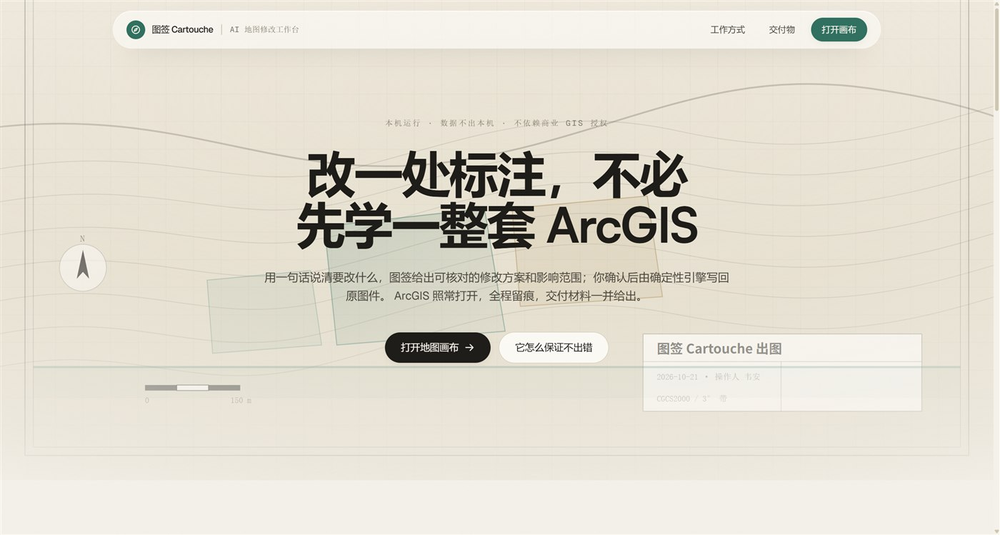
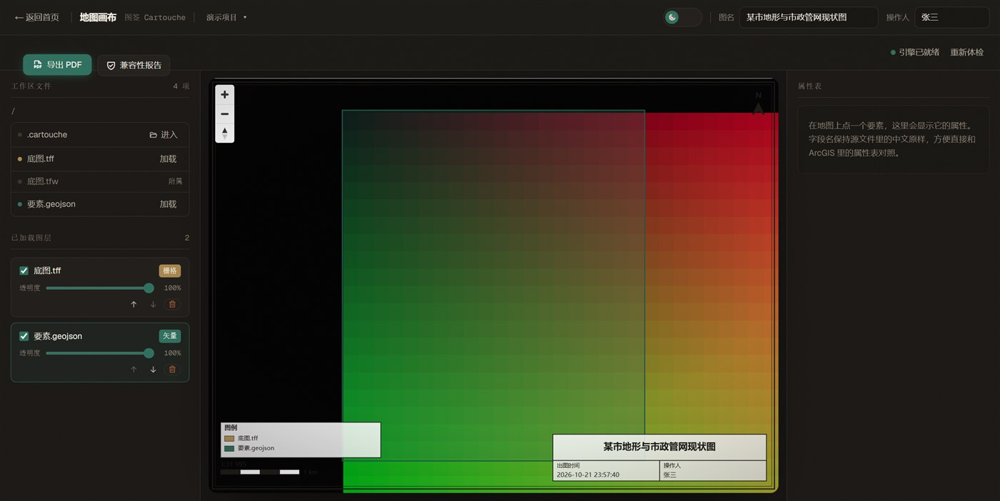
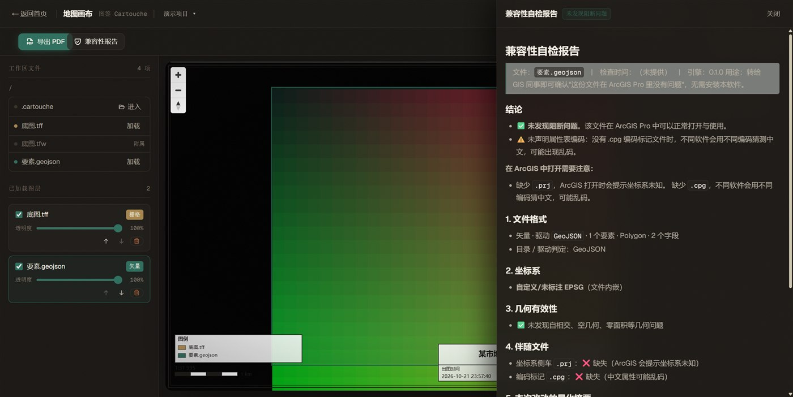
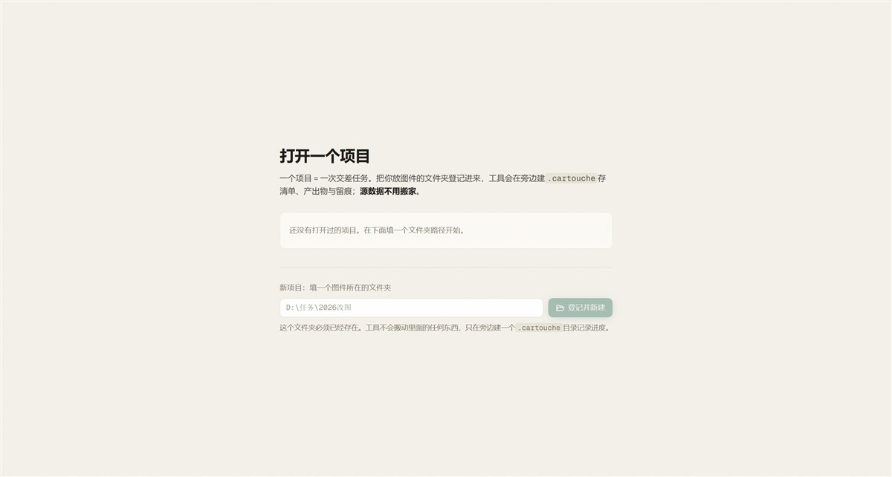

# 图签 Cartouche

[](https://github.com/Echovagant/cartouche/actions/workflows/ci.yml)

> 改一处标注，不必先学一整套 ArcGIS。



**图签**是一套跑在**本机**的地图出图工具。它给你一个确定性引擎去读图、改图、
**原子写回**原文件，并在交差之前把**兼容性体检**做掉——ArcGIS 照常打开原图件。

> **当前状态**：出图引擎、出图工作台、兼容性体检、项目化均已可用；
> "一句话改图"的 AI 对话入口正在接入（引擎侧的 23 个操作与四道闸门已就绪）。

---

## 截图

### 出图工作台



暗色制图台里，栅格与矢量叠在图框中；图名、操作人、图例、比例尺、出图时间都在图面上。
导出 PDF 得到的就是这一屏——所见即所交。

### 改之前先自检



出图前对图件做一次体检：文件格式、坐标系、几何有效性、伴随文件（`.prj` / `.cpg` 是否齐全）、
编码、拓扑、变化检测。**缺什么、会出什么问题、怎么改**，逐条写清——
不用等打开 ArcGIS 才发现"坐标系未知"。

### 项目化：源数据原地



一个项目 = 一次交差任务。把你放图件的文件夹登记进来，工具在**旁边**建一个
`.cartouche/` 放清单、产出物与留痕，**你的图件一个字节都不会被搬动或改写**。
关掉再打开，图层、顺序、透明度、图名、视角全部回到上次出图的状态。

---

## 它能做什么

| | |
|---|---|
| **改完不影响原文件** | 临时文件 → 校验 → 原子替换 → 自动备份。任何一步失败，原文件保持原样 |
| **占用检测** | ArcGIS 打开数据时会持有句柄；占用时直接拒绝写入，不硬来 |
| **写回可回退** | 每次写回都留一份带时间戳的备份，回滚是"复制回去" |
| **坐标系与伴随文件** | `.prj` / `.cpg` / `.tfw` / `.wld` 随主文件一起读写，ArcGIS 打开不报"坐标系未知" |
| **不依赖商业 GIS 授权** | 引擎是纯 TypeScript + GDAL 命令行，浏览器打开即用 |
| **数据不出本机** | 服务只监听回环地址；模型密钥用 DPAPI 加密存在仓库之外，从不明文落盘 |
| **AI 只提议，绝不执行** | 模型的唯一产物是一份操作计划；执行永远由确定性引擎完成，且要过四道闸门 |

**四道闸门**（每一次写回都要过）：

```
操作计划 Schema 校验 → 引擎前置校验 → 量化影响报告 → 人工确认
```

影响报告给出的是**数字**：影响了多少像元、涉及多少要素、净面积变化多少、拓扑检查结果如何。

---

## 快速开始

**前置**：Node.js ≥ 22、GDAL 命令行（Windows 上推荐 conda-forge 发行版）。

```bash
# 装 GDAL（仅 conda-forge 通道，走国内镜像）
powershell -ExecutionPolicy Bypass -File scripts/setup-conda-gdal.ps1

# 环境自检：Node / GDAL / 驱动覆盖 / 就绪度
npm run doctor
```

### 打开出图工作台

画布是**静态导出**的纯前端页面，能力由独立的引擎进程提供。
**必须用 http 打开**——Chrome 禁止从 `file://` 构造 Web Worker，MapLibre 起不来，地图会一片空白。

```bash
# 1) 拉公开样本并播种进工作区
npm run samples
npm run samples:seed

# 2) 起引擎（另开一个终端）
npm run dev:server

# 3) 构建前端并用静态服务器打开
npm run build:web
npm run serve:web         # http://127.0.0.1:8080/canvas.html
```

引擎默认只放行**回环来源**（`http://127.0.0.1:<端口>` / `http://localhost:<端口>`），
外网来源一律被浏览器拦下；要放行别的来源就设 `ENGINE_ALLOWED_ORIGINS=a,b`。

---

## 模型接入

v1 只落地 **MiniMax 国内版**，base_url `https://api.minimax.cn/v1`（OpenAI 兼容）
与 `https://api.minimax.cn/anthropic`（官方推荐）。当前可用模型：
**`MiniMax-M3.1-Flash`**、**`MiniMax-M3`**（1M 上下文）。

```ts
const provider = new MiniMaxProvider({
  readApiKey: () => process.env.MINIMAX_API_KEY ?? null,
  model: 'MiniMax-M3.1-Flash',
});
```

`KeyProvider` 是接口，换一家模型只改这一个实现，引擎与网关不动。

### 密钥怎么放

**API Key 不进 GitHub，也不以明文保存。** 磁盘上只允许出现 DPAPI 密文。

```powershell
# 交互输入 → DPAPI 加密 → 存到 %LOCALAPPDATA%\cartouche\llm-key.txt
powershell -NoProfile -ExecutionPolicy Bypass -File scripts\set-key.ps1

# 启动引擎：自动解密并注入当前进程（不回显 Key）
powershell -NoProfile -ExecutionPolicy Bypass -File scripts\run-engine.ps1
```

- 密文**绑定当前 Windows 用户**，别的账号、别的机器都解不开；文件在**仓库之外**
- 也可以在 Web 界面里粘贴——只驻留内存，服务重启即失效
- `GET /api/llm/status` **只返回** `configured` / `source`，**永不返回 Key 本身**

---

## 开发

```bash
npm run test:ci          # 单元测试（串行）
npm run check:schema     # 操作计划契约自检
npm run check:licenses   # 依赖许可门禁
npm run check:secrets    # 密钥扫描门禁：防 API Key 误提交
npm run scan:encoding    # 编码污染扫描
npm run smoke:engine     # 引擎服务冒烟测试
npm run build:web        # 构建静态前端产物
```

一个项目目录长这样（`.cartouche/` 旁挂在源数据旁边，源数据本身不动）：

```
D:\任务\2026改图\          ← 你自己的图件，原样保留
├─ 底图.tff
├─ 底图.tfw
└─ .cartouche\             ← 工具只在这个目录里放自己的东西
   ├─ project.json         ← 清单（纯 JSON，人可读）
   ├─ history.jsonl        ← 留痕，一行一次操作
   └─ outputs\             ← 产出的 PDF / 报告
```

### 目录结构

```
src/engine/    引擎：操作计划 Schema、出图与写回、密钥提供方、工作区与项目模型
server/        引擎服务（HTTP 接口 + 密钥状态管理）
web/           前端静态壳（Next.js 静态导出；canvas/ 是地图画布）
scripts/       开发脚本：环境自检、样本生成、依赖安装、门禁
bench/         AI 基准集
```

---

## 安全

- 服务端不持久化模型密钥，不做遥测，不含任何自动更新
- 浏览器只与本机/内网服务通信；是否连接外部模型由使用者自行配置
- 所有写回操作留痕，审计日志可导出
- 路径只能落在**已登记的工作区根**之下，越界一律拒绝

## 许可

[Apache-2.0](LICENSE)。本项目不包含、不分发任何 Esri 专有软件或数据；ArcGIS 是 Esri 的注册商标。
第三方组件许可见 [NOTICE](NOTICE)。
